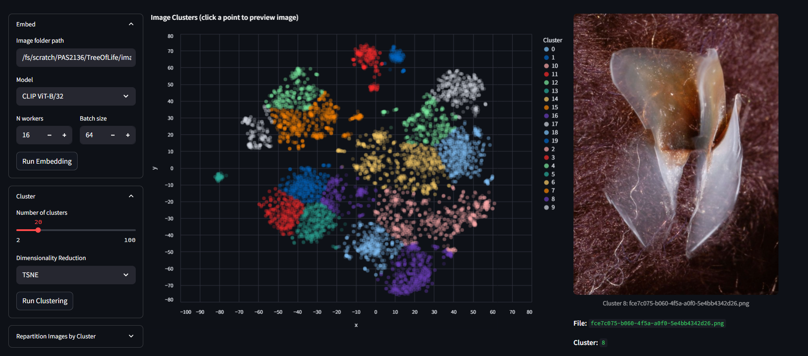
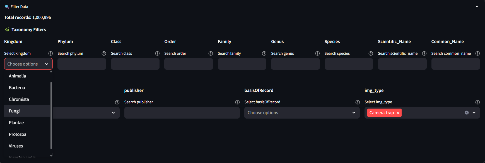
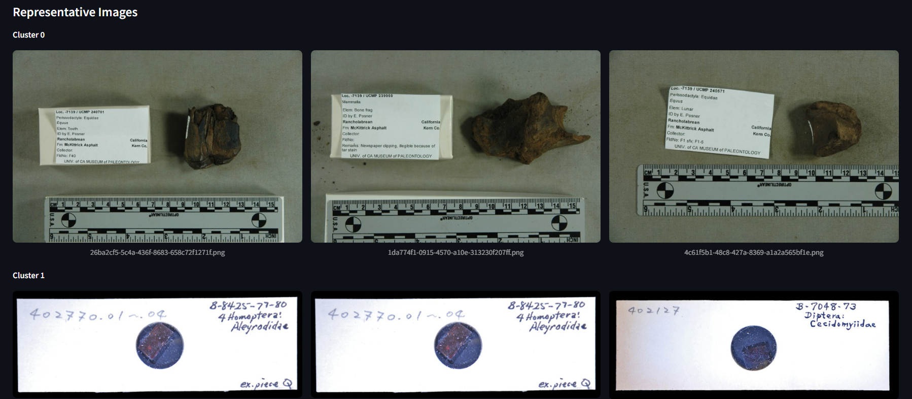
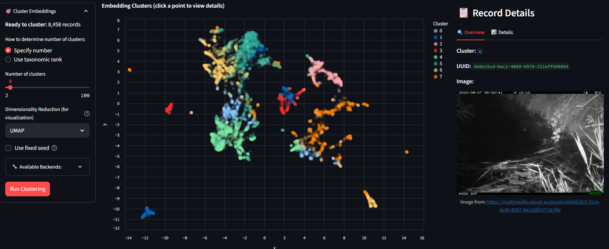
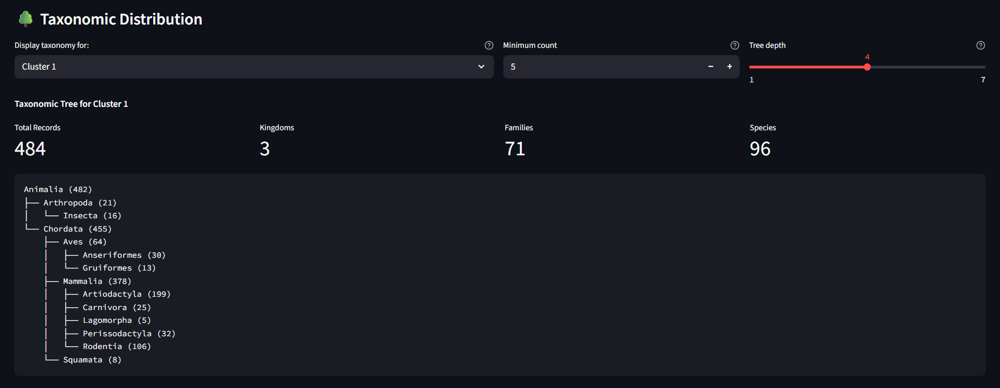
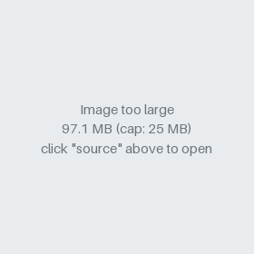

# Image Embedding Explorer
[](https://doi.org/10.5281/zenodo.18841337)

Visual exploration and clustering tool for image embeddings. Users can either bring pre-calculated embeddings to explore, or use the interface to embed their images and then explore those embeddings.

## Screenshots

<table>
  <tr>
    <td width="50%" align="center"><b>Embed & Explore</b></td>
    <td width="50%" align="center"><b>Precalculated Embedding Exploration</b></td>
  </tr>
  <tr>
    <td></td>
    <td></td>
  </tr>
  <tr>
    <td></td>
    <td></td>
  </tr>
  <tr>
    <td></td>
    <td></td>
  </tr>
</table>

## Features

**Embed & Explore** - Embed images using pretrained models (CLIP, BioCLIP), cluster with K-Means, visualize with PCA/t-SNE/UMAP, and repartition images by cluster.

**Precalculated Embeddings** - Load parquet files (or directories of parquets) with precomputed embeddings, apply dynamic cascading filters, and explore clusters with taxonomy tree navigation. See [Data Format](docs/DATA_FORMAT.md) for the expected schema and [Backend Pipeline](docs/BACKEND_PIPELINE.md) for how embeddings flow through clustering and visualization.

**Representative Images** - After KMeans, both apps show the three records closest to each cluster's centroid. Each tile carries the record name, a short id that copies the full id on click, and a source link that opens the image in a new tab; images that fail to load are skipped in favor of the next-closest record, and images over the 25 MiB download cap are shown as a placeholder with their source link intact. The example below is KMeans on [BioCLIP 2](https://huggingface.co/imageomics/bioclip-2) embeddings of a sample of canid images. See [Representative Images](docs/REPRESENTATIVE_IMAGES.md) for how selection and fallback work.

<table>
  <tr>
    <td colspan="3"><b>Cluster 1</b></td>
  </tr>
  <tr>
    <td>Canis simensis<br><code>dbb9ca8f</code> · <a href="https://inaturalist-open-data.s3.amazonaws.com/photos/334339733/original.jpg" target="_blank">source</a></td>
    <td>Canis simensis<br><code>70f9ab9f</code> · <a href="https://inaturalist-open-data.s3.amazonaws.com/photos/134581592/original.jpeg" target="_blank">source</a></td>
    <td>Canis simensis<br><code>4de7a1cf</code> · <a href="https://inaturalist-open-data.s3.amazonaws.com/photos/345255557/original.jpg" target="_blank">source</a></td>
  </tr>
  <tr>
    <td></td>
    <td></td>
    <td></td>
  </tr>
  <tr>
    <td colspan="3"><b>Cluster 2</b></td>
  </tr>
  <tr>
    <td>Canis lycaon<br><code>ea070e30</code> · <a href="https://inaturalist-open-data.s3.amazonaws.com/photos/176686074/original.jpeg" target="_blank">source</a></td>
    <td>Canis lycaon<br><code>55af17f4</code> · <a href="https://inaturalist-open-data.s3.amazonaws.com/photos/176686067/original.jpeg" target="_blank">source</a></td>
    <td>Canis lycaon<br><code>a7edd26f</code> · <a href="https://inaturalist-open-data.s3.amazonaws.com/photos/104417928/original.jpg" target="_blank">source</a></td>
  </tr>
  <tr>
    <td></td>
    <td></td>
    <td></td>
  </tr>
</table>

<sub>Photos [CC BY-NC 4.0](https://creativecommons.org/licenses/by-nc/4.0/deed.en): Björn Reese, Miguel A. Casado, Bill Fintel, corium.</sub>

## Installation

Requires Python 3.10–3.13. We recommend using [uv](https://github.com/astral-sh/uv) for package management.

```bash
git clone https://github.com/Imageomics/emb-explorer.git
cd emb-explorer

# Create venv with Python 3.12 (3.14+ not yet supported by GPU dependencies)
uv venv --python 3.12 && source .venv/bin/activate
uv pip install -e .
```

### GPU Acceleration (optional)

A GPU is **not required** — everything works on CPU out of the box. But if you have an NVIDIA GPU with CUDA, clustering and dimensionality reduction (KMeans, t-SNE, UMAP) will be significantly faster via [cuML](https://docs.rapids.ai/api/cuml/stable/).

```bash
# CUDA 12.x 
uv pip install -e ".[gpu-cu12]"

# CUDA 13.x
uv pip install -e ".[gpu-cu13]"
```

The app auto-detects GPU availability at runtime and falls back to CPU if anything goes wrong — no configuration needed. The CPU sklearn path is auto-accelerated by [scikit-learn-intelex](https://github.com/uxlfoundation/scikit-learn-intelex)[^1]. You can also manually select backends (`cuML`, `sklearn`) in the sidebar.

## Usage

### Standalone Apps

```bash
# Embed & Explore - Interactive image embedding and clustering
streamlit run apps/embed_explore/app.py

# Precalculated Embeddings - Explore precomputed embeddings from parquet
streamlit run apps/precalculated/app.py
```

### Entry Points (after pip install)

```bash
emb-embed-explore    # Launch Embed & Explore app
emb-precalculated    # Launch Precalculated Embeddings app
list-models          # List available embedding models
```

### Example Data

An example dataset (`data/example_1k.parquet`) is provided with BioCLIP 2 embeddings for testing. Please see the [data README](data/README.md) for more information about this sample set.

### Remote HPC Usage

```bash
# On compute node
streamlit run apps/precalculated/app.py --server.port 8501

# On local machine (port forwarding)
ssh -N -L 8501:<COMPUTE_NODE>:8501 <USER>@<LOGIN_NODE>

# Access at http://localhost:8501
```

## Acknowledgements

[OpenCLIP](https://github.com/mlfoundations/open_clip) | [Streamlit](https://streamlit.io/) | [Altair](https://altair-viz.github.io/)

[^1]: [`sklearn-intelex`](https://github.com/uxlfoundation/scikit-learn-intelex) is powered by the [oneDAL](https://github.com/uxlfoundation/oneDAL) library that provides accelerations on x86_64 Linux and Windows machines, and silently fall back to vanilla `sklearn` on unsupported architectures like Apple Silicon and ARM Linux. The package is under the [UXL Foundation](https://github.com/uxlfoundation) (a Linux Foundation project) so cross-vendor support is a stated goal.
