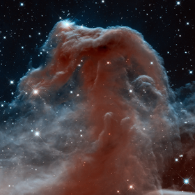
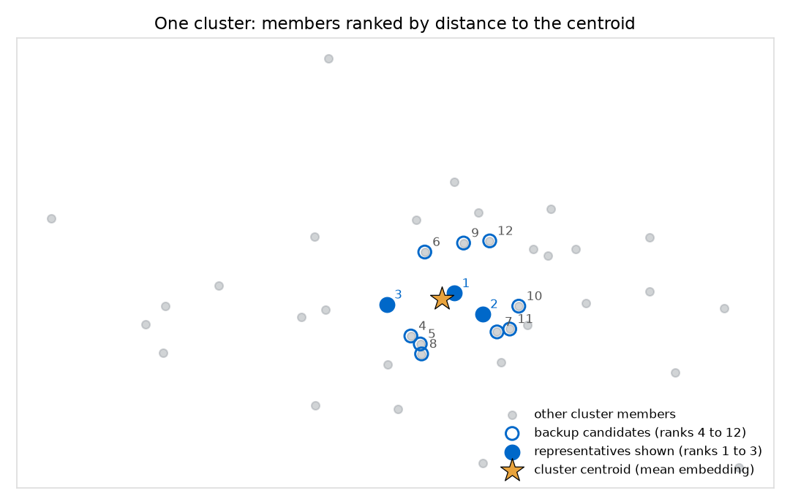
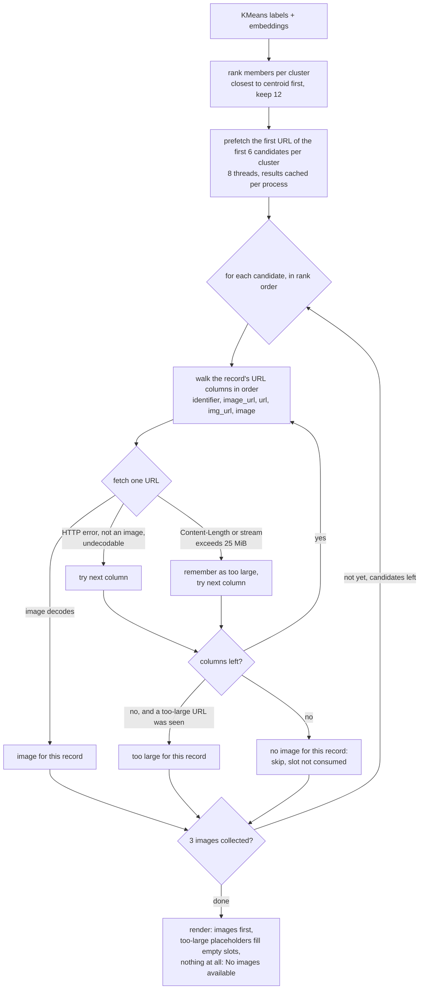
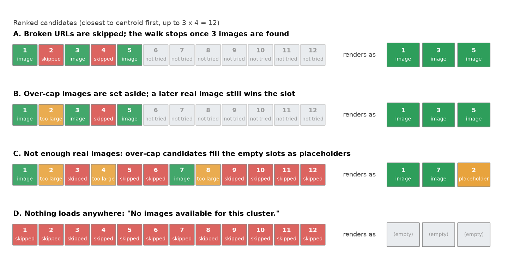

# Representative images per cluster

After a KMeans run, both apps show a **Representative Images** panel: for every cluster, up to three images of the records that sit closest to the cluster's center. This page explains how those records are chosen, how their images are loaded, what happens when an image cannot be shown.

## 1. Overview: What the panel shows

Each cluster is one card. Inside it, every tile has a short header above the image:

- the record's name (`scientific_name`, else `species`, `common_name`, or the uuid; in Embed & Explore the tile shows a single `File path` label instead),
- a **short id** that copies the full uuid (or file path) to the clipboard when clicked; hovering previews the full value,
- a **source** link that opens the fetched image URL in a new tab.

The example card below mixes two rendered images with one that was too large to download. The third tile is the app's own placeholder, drawn by the same function the app uses, and its "source" link still opens the original.

<table>
  <tr>
    <td width="33%" align="center"><b>Cluster 2</b></td>
    <td width="33%"></td>
    <td width="33%"></td>
  </tr>
  <tr>
    <td>Sombrero Galaxy <code>3f1c9a0b</code> · <a href="https://cdn.esahubble.org/archives/images/large/heic0407a.jpg">source</a></td>
    <td>Horsehead Nebula <code>9a77e2d1</code> · <a href="https://cdn.esahubble.org/archives/images/large/heic1307a.jpg">source</a></td>
    <td>Cosmic Reef <code>51be0c3e</code> · <a href="https://cdn.esahubble.org/archives/images/large/heic2007a.jpg">source</a></td>
  </tr>
  <tr>
    <td></td>
    <td></td>
    <td></td>
  </tr>
</table>

Example images: ESA/Hubble (CC BY 4.0). The third source is a 97 MiB file, above the app's 25 MiB download cap, so the app shows the placeholder instead of fetching it.

A cluster whose records all fail to load shows the caption *"No images available for this cluster."* instead of tiles.

## 2. How representatives are chosen

For each cluster, the app takes the mean of its members' embeddings (the **centroid**, computed in the full embedding space, not in the 2D projection) and ranks the members by squared Euclidean distance to it. The closest three are the representatives.

In symbols: let $x_i \in \mathbb{R}^D$ be the embedding of record $i$ (for BioCLIP 2, $D = 768$) and $C_k = \{\, i : \text{label}_i = k \,\}$ the members of cluster $k$. The centroid and each member's distance to it are

$$
\mu_k = \frac{1}{|C_k|} \sum_{i \in C_k} x_i,
\qquad
d_i = \lVert x_i - \mu_k \rVert^2 = \sum_{j=1}^{D} (x_{ij} - \mu_{kj})^2 .
$$

Sorting the members of $C_k$ by $d_i$ ascending gives the ranked list $r_1, r_2, \dots$; the app keeps the first

$$
K = \min\big(n \cdot o,\; |C_k|\big), \qquad n = 3,\; o = 4,
$$

as **candidates**, and the **representatives shown** are the first $n$ of those whose image can be displayed. With every image loadable they are simply $r_1, r_2, r_3$.

The ranking is **oversampled** by the factor $o$: the app keeps 4 times as many candidates as it intends to show (12 for 3 slots, or the whole cluster if it is smaller). The extra candidates are backups, used only when an image cannot be shown. Representatives therefore never change because of a broken URL: the same three records are tried first every time; a failure moves on to the fourth-closest, and so on.

Two details of the implementation: ties in $d_i$ are broken by record order, and $\mu_k$ is computed on the embeddings as stored in the dataset, whereas KMeans itself clusters L2-normalized copies, so for unnormalized embeddings a member's rank can differ slightly from its rank by distance to the normalized centroid.

Two consequences worth knowing:

- Representatives depend only on the embeddings and the KMeans labels, not on the projection method; PCA, t-SNE and UMAP views of the same KMeans run share the same representatives.
- A cluster with fewer than three loadable images shows fewer tiles rather than borrowing from another cluster.

## 3. How images are loaded, and what happens when they cannot be

In words, there are two fallback layers:

1. **Per record, across URL columns.** A record may hold image URLs in several columns (`identifier`, `image_url`, `url`, `img_url`, `image`; see [`shared/utils/images.py`](../shared/utils/images.py)). The app tries them in that order and uses the first one that actually loads. A broken column moves on to the next. A column whose image is over the size cap also moves on; it is remembered only if no column loads.
2. **Per cluster, across candidates.** The renderer walks the ranked candidates until it has three real images. A record with nothing loadable is skipped and consumes no slot. A record whose best outcome is "too large" is set aside; real images fill the slots first, and the set-aside records fill only the slots that would otherwise stay empty, as placeholder tiles. If there is nothing at all, the cluster shows the empty caption.

### Why there is a size cap

The cap originates from a [GitHub Copilot review comment on the feature PR](https://github.com/Imageomics/emb-explorer/pull/42#discussion_r3598642716), which pointed out that the first version read every response into memory with no limit, so a malicious or misconfigured URL returning a very large payload could drive memory use up and stall the app. The app now refuses any image larger than 25 MiB: it checks the declared Content-Length before reading a single byte, and it also counts bytes while streaming and stops as soon as the limit is passed, since a server can omit or misstate Content-Length.

Every fetch result is cached for the lifetime of the app process, including failures and too-large verdicts, so switching views or re-running KMeans does not refetch, and a dead URL is tried at most once per session. Fetches time out after 5 seconds.

## 4. Known limits

HTTP 429 (rate limiting) and 503 are treated like any other failure, with no retry. Hosts that throttle the app's User-Agent, Wikimedia Commons for example, can make a cluster look empty.
